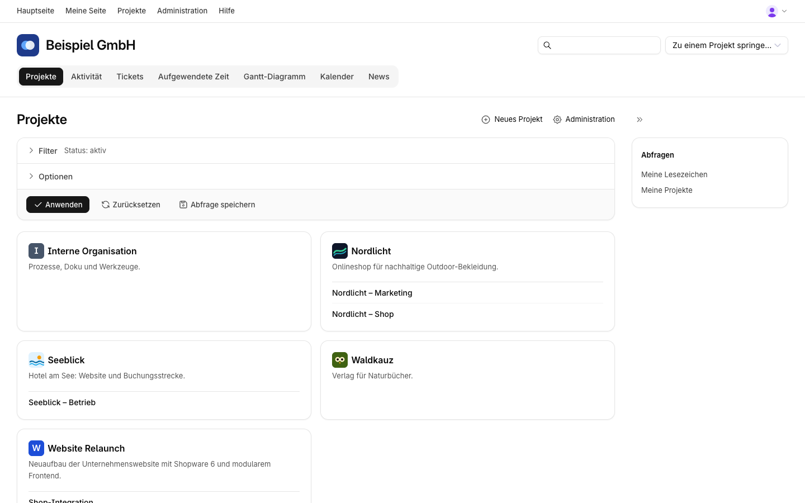
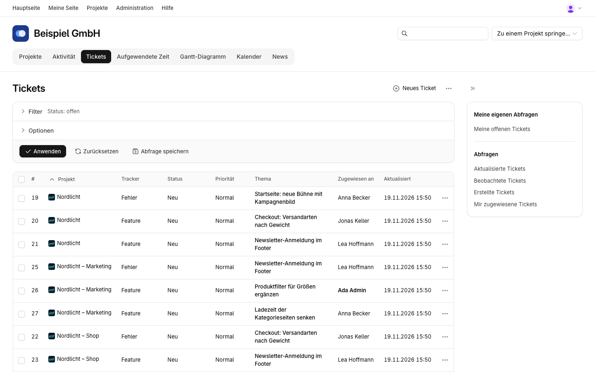
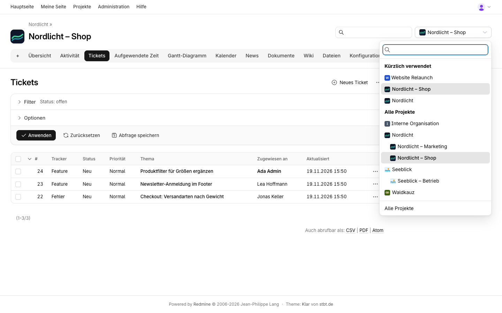
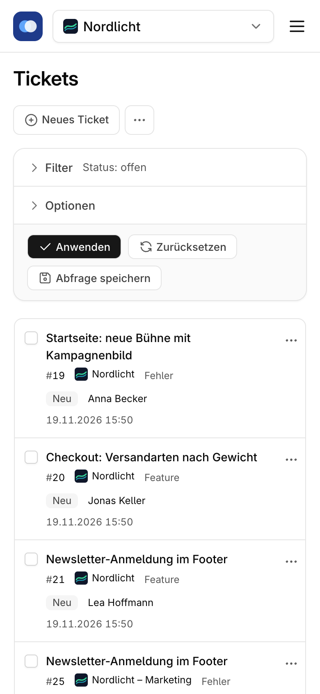
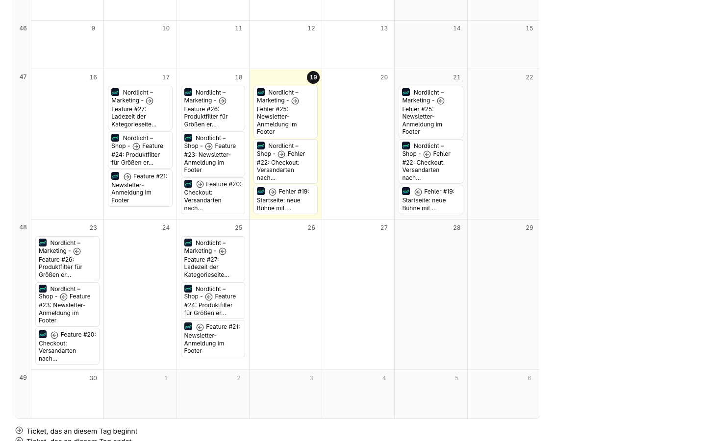
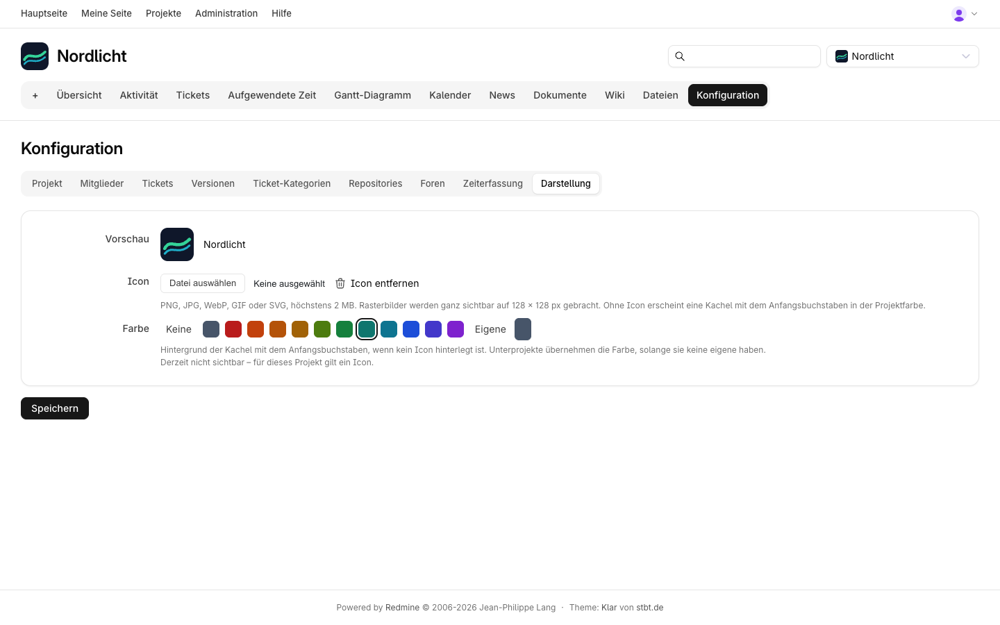

# Project Icons – icons and colours for Redmine projects

Give every project an icon and a colour. Subprojects inherit both from their nearest
parent that has one – so a customer's logo appears on all of its projects at once. In
lists, the header and the planning views you see at a glance which project, which
customer, something belongs to.

- **Icon per project:** PNG, JPG, WebP, GIF or SVG, up to 2 MB. Raster images are fitted
  (fully visible) into 128 × 128 px.
- **Colour per project:** twelve tuned colours or a custom one. Without an icon a tile
  with the first letter in the project colour is shown.
- **Inheritance:** subprojects use the icon and colour of the nearest parent until they
  set their own; icon and colour are inherited independently.
- **Where they appear** – each can be switched off under
  *Administration → Plugins → Project Icons → Configure*:
  - project list (larger for projects; subprojects only with an icon or colour of their
    own – they sit right under their parent anyway),
  - issue lists, spent time, *My page* and versions (column "Project"),
  - header (before the project title) and "Jump to a project",
  - calendar and Gantt chart.

Managed in each project's settings, tab *Appearance*, by everyone who may edit the
project. Works with any theme;
[Klar](https://github.com/stbt-de/redmine-klar-theme) is styled for it.

## Screenshots

*Shown with the [Klar theme](https://github.com/stbt-de/redmine-klar-theme) and example data.*

Project list – subprojects appear only if they have an icon of their own:



Issue list across projects – the customer is recognisable in every row:



| Project selector | Issue list on mobile |
| --- | --- |
|  |  |

Calendar:



Project settings, tab *Appearance*:



## Installation

The folder in `plugins/` must be named `redmine_project_icons`.

**Release zip:** download `redmine-project-icons-v*.zip` from the
[releases](https://github.com/stbt-de/redmine-project-icons/releases) and unpack it in the
`plugins/` directory (it contains the folder `redmine_project_icons/`).

**Or clone:**

```
cd /path/to/redmine/plugins
git clone https://github.com/stbt-de/redmine-project-icons.git redmine_project_icons
```

Then run the plugin migration and restart Redmine:

```
bundle exec rake redmine:plugins:migrate NAME=redmine_project_icons RAILS_ENV=production
```

Until the migration has run, the plugin simply shows nothing – Redmine keeps working.
Raster images are processed with ImageMagick (`convert`), which Redmine already uses for
thumbnails; the official Redmine Docker image includes it.

To uninstall: `bundle exec rake redmine:plugins:migrate NAME=redmine_project_icons VERSION=0 RAILS_ENV=production`,
then remove the folder and restart Redmine.

### Tested with

| Redmine | Ruby | Rails | Checked |
| --- | --- | --- | --- |
| 7.0.3 | 4.0.10 | 8.1.4 | integration tests; in the browser with the themes Default and Klar (desktop, mobile) |
| 6.1.6 | 3.4.13 | 7.2.4 | integration tests |
| 6.0.12 | 3.3.14 | 7.2.3.2 | integration tests |

The plugin requires Redmine 6.0 or later. The interface is available in English and
German.

## How it works

- Icon and colour are stored in a small table (`project_icons`); the image files live in
  Redmine's files directory (`files/redmine_project_icons/`) and are backed up together
  with attachments.
- Inheritance uses Redmine's project tree (nested set): the few projects with an icon or
  colour are read once per request, so lists with many projects need no extra queries.
- Icons are served at `/projects/<identifier>/icon` – only to users who may see the
  project, cached privately; a new icon gets a new URL. SVG files are served with
  `Content-Security-Policy: sandbox`, so embedded scripts do not run. The file type is
  detected from the content, not the name.
- Icons are inserted server-side where Redmine renders project links (project list, issue
  lists, Gantt) and the page title. The project selector and the calendar are completed
  by a small script (`project_icons.js`), because Redmine builds them in a way plugins
  cannot extend.
- When a project is deleted, its icon is deleted too.

### For theme authors

Icons are `img.project-icon` or `span.project-icon-tile` with the custom properties
`--project-icon-size` and `--project-color`. The plugin's base styles are wrapped in
`:where()` and can be overridden without a specificity fight.

On project pages the plugin also writes `<meta name="project-icon" content="…"
data-color="…" data-letter="…">` (`content` is empty without an image). Themes that draw
the logo themselves (`data-branding-logo="theme"` on `<html>`) can show the project icon
in its place – Klar does so on desktop. On mobile, keep the logo: it is the way back to
the start page; the project icon is shown in "Jump to a project" next to it. The plugin
itself never hides the mobile logo of redmine-branding.

## Development

Tests run against a fresh Redmine in a container (Docker required):

```bash
dev/run-tests.sh                        # Redmine 7.0
REDMINE_VERSION=6.1 dev/run-tests.sh    # another version
```

Code comments are written in German.

## Built with AI assistance

This plugin was developed together with an AI coding assistant. Most of the code was
written by the assistant; the direction, design decisions and review came from
[stbt.de](https://stbt.de/). Every feature is covered by integration tests and was
checked in a running Redmine.

## License

MIT, see [`LICENSE`](LICENSE).
